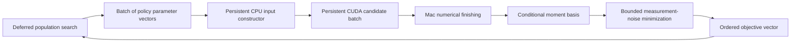

# Version 0.2.0: CUDA search pipeline

This version connects parameter search to the CUDA model evaluators. The
production path constructs inputs without a CPU policy solve and returns an
objective without requiring CPU reference solution arrays. Independent
reference comparisons remain a separate validation tool.

For the configuration with recorded fixed-vector bitwise agreement, use
[Mac input construction with a remote CUDA worker](#keep-input-construction-on-the-validated-host).
Version 0.2.0 keeps input construction, numerical finishing, conditional
selection and optimizer control on the Mac. The server supplies the persistent CUDA evaluator.



## Components and numerical contract

- `gpu.py` provides build, evaluation and search commands.
- `cuda_pipeline.py` manages the two persistent workers, input binding,
  candidate ordering, batch-size limits, objective calculation and records.
- `src/fortran/prepare_cuda_inputs.F90` calls the packaged discretization
  routine and constructs fixed-draw exogenous paths and action-input caches.
  It reads the fixed draws once per worker and computes their normal transform
  once. It never calls policy iteration, stationary distribution solution,
  model simulation, or the SMM objective. Parameter-dependent inputs are rebuilt
  for every candidate; cached allocations do not substitute a previous solution.
- `src/cuda/re_native_parallel.cu` and
  `src/cuda/de_native_simulation_parallel.cu` solve independent candidates in
  GPU batches. Their server interface retains the CUDA context and allocation
  pool across requests. Every candidate still starts from the standard cold
  policy initialization.
- `src/fortran/finalize_numeric.f90` finishes the macro growth variance and
  direct weighted objective on the Mac. The remote worker returns its already
  computed macro output path; this small local calculation preserves the host
  log implementation and Fortran accumulation/reduction order. Remote
  intermediate moments are retained in the logs; final pipeline moments
  include this local finishing step.
- Conditional profiling solves the policy once, then evaluates the measurement
  transformation at zero, plus one and minus one. The macro path is shared
  across those three lanes. The existing polynomial minimizer selects the
  measurement-noise parameter within the user-specified interval. This uses
  eight outer coordinates for RE and nine for DE.
- The objective uses the packaged targets, weights and moments 2 through 17.
  Nonfinite selected moments yield an invalid objective; an unused auxiliary
  moment does not silently become an additional admissibility condition.
  Infrastructure failures stop the run rather than becoming numerical penalties.

The input constructor preserves the action-screening cache's rounded investment
subtraction and fused capital-cost combination explicitly. Exact action
rescoring retains its separate arithmetic. This distinction is checked against
independently produced input arrays.

## From search to GPU kernels

| Layer | Work and implementation |
|---|---|
| Search scheduling | Freeze the population for one generation, generate its trial vectors, evaluate them in ordered batches, then update the population. `gpu.py` owns this schedule. |
| Parameter reduction | Profile `sigma_pi` outside the expensive policy solve; search eight RE or nine DE policy coordinates. |
| Input construction | Build each candidate's grids, transitions, exogenous paths and action caches. Reuse fixed draws, never a different candidate's policy. |
| Candidate batching | Each candidate has independent state, buffers and stopping flags; GPU launches cover the candidate axis as well as model states. |
| Policy solution | Compact transitions, cooperative action shortlists, sparse winners and compact Howard groups preserve the established arithmetic and tie handling. RE also uses its reduced state representation. |
| Distribution and simulation | Stable destination adjacency preserves accumulation order; zero-mass work and unused observations are skipped. Independent candidates finish in separate host workers and CUDA streams. |
| Numerical finishing | Return the macro path and compute its growth variance and the direct weighted objective with the Mac Fortran helper. |
| Conditional objective | Share the macro path across the three measurement-noise lanes, form the moment polynomial, minimize it over the declared interval, then return one objective per candidate in order. |

Kernel-level descriptions and their original incremental measurements are in
[the GPU technique table](gpu-v010.md#how-the-techniques-work). Version 0.2.0
adds the connected execution path and production interface around those kernels.

This design fits population search, predeclared grids and batches from independent
search starts. A sequential optimizer that needs one result before proposing
the next point cannot automatically use a batch of future candidates. Changing
it to deferred or speculative evaluation changes its scheduling semantics;
the supplied driver makes the deferred choice explicit.

## Build

On the GPU server, build the CUDA evaluators with GNU Fortran, CUDA Toolkit
and Python. On the Mac, use GNU Fortran, Python, NumPy, SciPy and SSH for input
construction and orchestration. Build each model separately on the server:

```bash
python3 gpu.py build RE --output build/gpu-re --arch 80
python3 gpu.py build DE --output build/gpu-de --arch 80
```

Set `--fc` and `--nvcc` for compilers outside `PATH`. `--inputs-only` builds the local input constructor and numerical-finishing
library; that build cannot run a
GPU evaluation on its own; it can supply inputs to the SSH workflow below.
Each full build records source identities, binaries, compiler
versions and flags. Existing build directories are never overwritten.

## Keep input construction on the validated host

The release retains the Mac input-construction, numerical-finishing and conditional-selection
implementations. Build the input constructor on the Mac and the CUDA backend
on the GPU server:

```bash
# On the Mac (set --fc if GNU Fortran is outside PATH):
python3 gpu.py build RE --inputs-only --output build/mac-re
python3 gpu.py build DE --inputs-only --output build/mac-de

# On the GPU server, in its copy of the toolkit:
python3 gpu.py build RE --output build/gpu-re --arch 80
```

Confirm SSH access and the server's host key before execution. Then, on the Mac:

```bash
python3 gpu.py evaluate --build build/mac-re \
  --parameters examples/re-policy.json --sigma-bounds 0 1.5 \
  --remote-host user@gpu-server --remote-build /absolute/path/build/gpu-re \
  --output runs/remote-re
```

The same remote options work with `gpu.py search`. Use `--remote-port`,
`--remote-key` and `--remote-known-hosts` when necessary. The transport verifies
the remote build and binary hash, transfers shared shocks once, and transfers
only each batch's new model inputs and job manifest. The GPU server process
persists across batches. The numerical finisher, conditional minimizer and optimizer remain local.
No CPU solution or previous search result is sent. Network setup and transfer
are included in remote pipeline timing.

Remote inputs remain in the recorded temporary directory for inspection; closing
the pipeline stops its worker, not the cloud instance. The user remains
responsible for instance lifecycle. The run record binds local and remote
builds separately. Bitwise agreement remains limited to the documented points
and execution environments.

## Evaluate

A direct evaluation accepts a complete parameter vector:

```bash
python3 gpu.py evaluate --build build/mac-re \
  --remote-host user@gpu-server --remote-build /absolute/path/build/gpu-re \
  --parameters examples/re-anchor.json --output runs/gpu-re-direct
```

A profiled evaluation accepts policy coordinates without `sigma_pi`:

```bash
python3 gpu.py evaluate --build build/mac-de \
  --remote-host user@gpu-server --remote-build /absolute/path/build/gpu-de \
  --parameters examples/de-policy.json --sigma-bounds 0 1.5 \
  --output runs/gpu-de-profile
```

To evaluate multiple candidates, use a JSON object containing `model` and a
`points` array. Each row has nine RE or ten DE parameters for direct evaluation,
or eight RE or nine DE policy parameters for profiling. The interval above is
an example configuration, not a prescribed estimation domain.

`--batch-size` limits simultaneous candidates (default 32, maximum 64).
`--simulation-workers` controls candidate-level simulation finishing (default
four). The optimizer's population may span multiple GPU batches. Splitting a
population does not update the optimizer until the full objective vector is
returned. A larger batch is not automatically faster; measure the intended
mixture of candidates and its memory use.

## Search

Provide a JSON specification with:

| Field | Meaning |
|---|---|
| `model` | `RE` or `DE` |
| `bounds` | Eight or nine explicit lower/upper pairs, in the policy-coordinate order in `docs/usage.md` |
| `sigma_pi_bounds` | Nonnegative lower and upper bounds for conditional profiling |
| `seed` | Nonnegative integer random seed |
| `max_evaluations` | Positive candidate-evaluation budget, including initialization |
| `population_multiplier` | Optional population multiplier, default five |
| `initial_population` | Optional array of at least five policy vectors within the bounds |
| `tol`, `atol` | Optional population stopping tolerances, defaults `1e-7` and zero |

Bounds must be selected for the intended research question. No estimation box
or scientific target is inferred by the runner. Require `|rho_z| < 1` and
strictly positive process standard deviations throughout the supplied bounds.

```bash
python3 gpu.py search --build build/mac-de --spec my-search.json \
  --remote-host user@gpu-server --remote-build /absolute/path/build/gpu-de \
  --output runs/gpu-de-search --batch-size 32 --simulation-workers 4
```

The search uses SciPy differential evolution, `best1bin`, deferred updates,
vectorized objective evaluation, and no polishing. A seed and the complete
specification are recorded. With the default population multiplier, RE has
40 and DE has 45 candidates per generation. These are optimizer populations;
they need not equal the GPU batch-size limit.

The comparator for search scheduling is the same deferred algorithm evaluated
serially. The old CPU runner's immediate-update trajectory is a different
algorithm configuration. Equal pointwise results do not imply that these two
update modes select the same candidates or endpoint. Scheduler tests check
candidate ordering against serial deferred updates using a deterministic test
objective; they are not a global-optimality or economic-validation test.

If a generation exceeds the remaining budget, the runner evaluates only its
ordered prefix, retains the best observed result, and stops without completing
that generation. It does not invent the missing objective values. The record
distinguishes attempted, completed and unique policy vectors. A timeout or
worker error produces a failed run record, and worker processes are closed.

## Outputs and timing

The run directory contains:

- `pipeline.json`: build/input identities, worker settings and startup time.
- `preparer/` and worker logs: input construction and GPU process records.
- `batch-*/inputs.json`: exact complete parameter bits and binary input hashes.
- `batch-*/results.json`: per-candidate moments or conditional bases, objectives,
  invalid-objective status and preparation/GPU/end-to-end batch times.
- `results.json` or `search.json`: final evaluation or search record.

Runtime outputs are ignored by Git. The GPU protocol binds results to the
ordered input batch; missing, duplicated or reordered candidate IDs are errors.
New candidates require no CPU solution files. Production mode explicitly says
that reference comparisons were not performed; a zero mismatch count is never
fabricated for an unchecked result.

Version 0.1.0 fixture-driven throughput remains a historical kernel measurement.
Version 0.2.0 end-to-end timing includes input-worker startup, CUDA startup,
parameter-dependent input construction, model solves, profiling, objective
formation and driver overhead. Search timing additionally includes candidate
generation and optimizer updates. `search_seconds` starts after worker setup;
`total_pipeline_seconds` includes setup and ends before worker shutdown.
With SSH, the GPU-request interval includes transfer and network latency.
These are hybrid CPU/GPU pipelines: input construction, simulation finishing,
profiling and optimizer control include CPU work. Neither timing may be substituted for the
other, and no historical kernel speedup is automatically a full-search gain.
